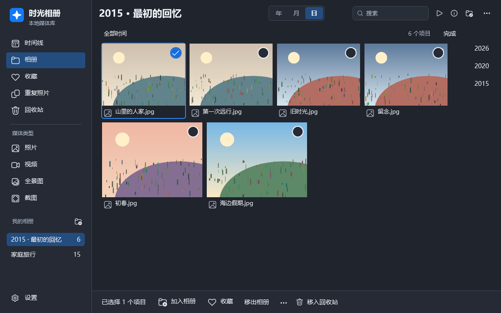

# 时光相册 · Shiguang Album

Windows 本地照片与视频媒体库。通过索引统一浏览多个来源文件夹，保留原有媒体位置。相册保存引用，同一张照片可以加入多个相册。**0.2.14** 将源码、问题反馈和软件更新统一到此仓库，见 [版本说明](docs/RELEASE-0.2.14.md)。

## 下载与开始使用

支持 Windows 10/11 x64。便携包包含 .NET 10 桌面运行时，解压后即可启动。

1. 打开 [最新版本下载页](https://github.com/dayesann/shiguang-album/releases/latest)，下载 `ShiguangAlbum-<版本>-win-x64.zip`。
2. 解压整个压缩包到可写目录，打开其中的 `运行程序-<版本>/拾光照片.exe`。
3. 点击“添加来源目录”，选择照片或视频所在文件夹。首次索引期间会显示进度。
4. 用时间线或相册浏览。批量整理时先点击“多选”，再勾选照片并操作。

压缩包根目录有快速入门与完整使用说明。`.runtime`、`Assets`、程序文件需要放在同一运行目录中。Release 同时提供 SHA-256 校验文件，GitHub 自动提供对应版本的源码压缩包。



图中使用程序生成的演示照片。完整操作见 [使用说明](使用说明.md)。

## 鼠标与键盘

| 场景 | 操作 |
|---|---|
| 普通浏览 | 单击定位，双击、Enter 或空格打开预览 |
| 多选 | 点击“多选”，单击、Enter 或空格勾选项目 |
| 网格导航 | 方向键移动焦点，Page Up / Page Down 翻页 |
| 删除 | 多选后按 Delete，核对范围并确认移入回收站 |
| 退出多选 | Esc 或点击“完成” |
| 搜索 | Ctrl+F，在搜索框中按 Esc 清空搜索 |
| 大图预览 | 方向键或 Page Up / Page Down 换片，F11 全屏，Esc 返回 |
| 幻灯片 | 空格播放或暂停 |

Ctrl+A 在多选模式中勾选当前已加载项目。滚动时会继续加载媒体。

## 已有功能

- 年、月、日时间线与自适应照片排版。
- 照片、HEIC、视频、全景图与截图分类。
- 虚拟相册、标签、收藏与搜索。
- 完全重复校验、近似照片人工复核、可恢复删除与回收站。
- 图片预览、图形化视频播放器、浅色／深色／跟随系统主题。
- 照片幻灯片、可调停留时间与循环、内置轻音乐及本地 BGM 选择。
- 完整媒体库迁移、相册资料备份与来源重新连接。
- 默认关闭到系统托盘，任务继续；再次启动同库恢复原窗口。

本项目目前只有 Windows 桌面端，没有手机应用或手机传输服务。HEIC、HEVC 等格式依赖 Windows 解码组件。仍在开发中，清理操作应先用测试副本验证。

## 数据位置与升级

便携包首次启动会在 `运行程序-0.2.12` 的同级目录创建 `数据/`，保存索引、相册关系、预览缓存和设置。原始媒体位于添加的来源目录。删除确认后，文件进入来源目录的 `.shiguang-trash`，可从应用回收站恢复。

从 0.2.13 开始，应用启动后会自动检测正式版，也可打开“设置 → 关于 → 软件更新”手动检查。可在应用里下载，等当前任务结束后重启启用新版。0.2.14 起更新统一由主仓库发布，见 [发布与软件更新](docs/UPDATES.md)。

0.2.12 及以前的版本须手动升级一次：先从“更多工具”或托盘退出旧版，把新的 `运行程序-<版本>/` 放到原有 `数据/` 的同级目录，然后启动新版。也可在“设置 → 备份与迁移 → 打开媒体库”选择原有 `library.sqlite`。更换电脑前请使用媒体库备份与迁移。

默认点击窗口关闭按钮会最小化到托盘。彻底退出请使用应用内“退出程序”或托盘菜单。

## 开发与构建

需要 Windows 10/11 x64、[.NET 10 SDK](https://dotnet.microsoft.com/download/dotnet/10.0)（Windows x64）与 PowerShell 7。没有第三方 NuGet 依赖，`NuGet.Config` 禁用了外部包源。

```powershell
git clone https://github.com/dayesann/shiguang-album.git
cd shiguang-album
pwsh -File .\构建.ps1
pwsh -File .\打包.ps1
```

构建脚本优先使用 `.tools/dotnet/dotnet.exe`，其次使用 PATH 中的 `dotnet`，也可通过 `-DotnetPath` 指定 SDK 程序。生成目录为 `成品/运行程序-<版本>/`，包含私有运行时；分发时应保留整个目录。

`打包.ps1` 从已构建的版本目录生成便携 ZIP、快速入门和 SHA-256 校验文件，输出至 `成品/发布-<版本>/`。

```powershell
# 独立演示库，不扫描正式来源
& '.\成品\运行程序-0.2.14\拾光照片.exe' --demo

# 无交互核心检查，适合 CI
pwsh -File .\自测.ps1 -CoreOnly

# 完整检查，需要可交互 Windows 桌面
pwsh -File .\自测.ps1
```

日常直接启动不带 `--demo` 的程序。打包目录位于 `成品` 下时，正式媒体库默认在 `成品/数据/`；通过 `--data <目录>` 可使用独立媒体库。媒体文件依然位于用户选择的来源目录。

## 项目结构

| 路径 | 用途 |
|---|---|
| `src/` | .NET 10 / WPF 应用、SQLite 索引及隔离测试 |
| `src/Assets/` | Fluent 图标、内置 AI 风景和许可明确的演示素材 |
| `工具/设计规范检查.ps1` | 静态设计检查 |
| `构建.ps1` / `打包.ps1` | 构建应用与生成 Release 便携包 |
| `DESIGN_SYSTEM.md` | 统一设计规范 |
| `DESIGN_RESEARCH.md` | 设计依据与参考资料 |
| `docs/` | 架构、验证范围与第三方素材说明 |
| `.github/workflows/` | Windows 构建、静态检查和核心回归 |

仓库包含源码、程序必需的内置素材、文档和使用生成素材拍摄的演示截图。可运行便携包位于 GitHub Releases，详细验证摘要见 [0.2.12 验证结果](docs/validation-0.2.12.json)。

## 继续开发

先阅读 [开发约定](AGENTS.md)、[设计规范](DESIGN_SYSTEM.md) 和 [贡献说明](CONTRIBUTING.md)。功能说明见 [使用说明](使用说明.md)，当前验证基线见 [验证范围](docs/VALIDATION.md)。CI 的核心检查不能替代实际 WPF 窗口、键盘、浅深主题和文件安全验收。

项目自有代码采用 [MIT 许可证](LICENSE)。第三方素材仍遵循各自许可证，详见 [第三方说明](docs/THIRD_PARTY_NOTICES.md)。
